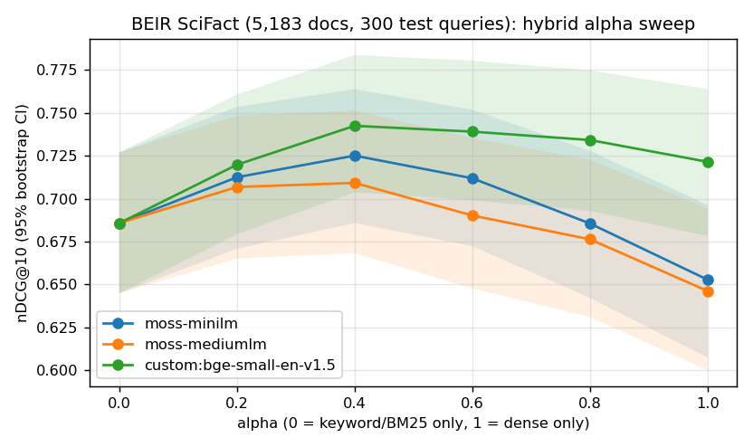
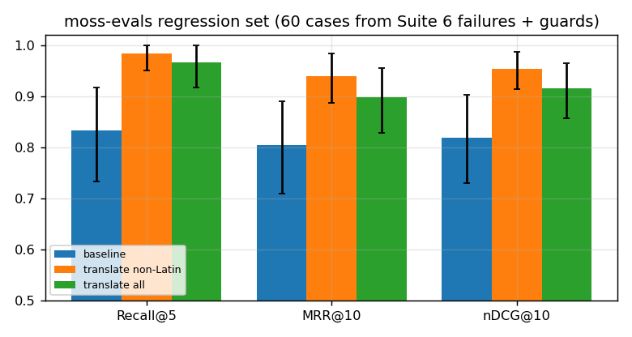
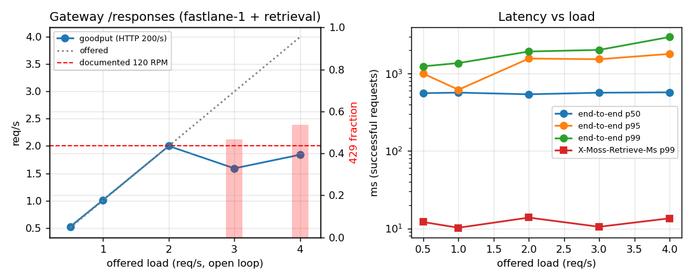
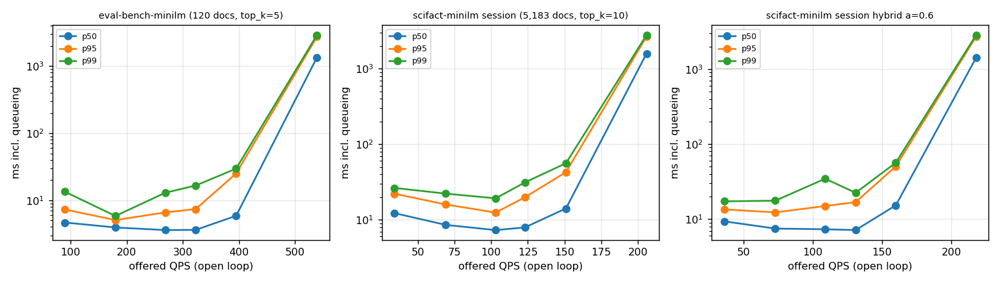
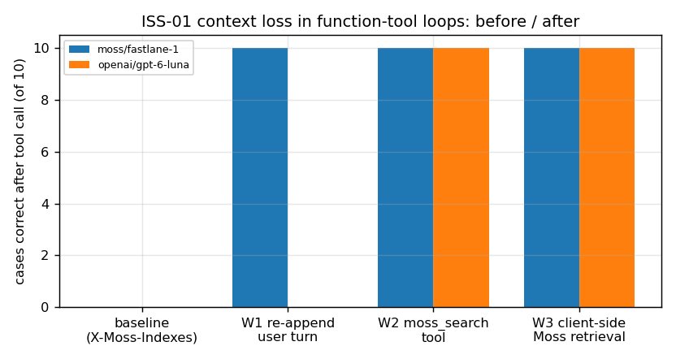
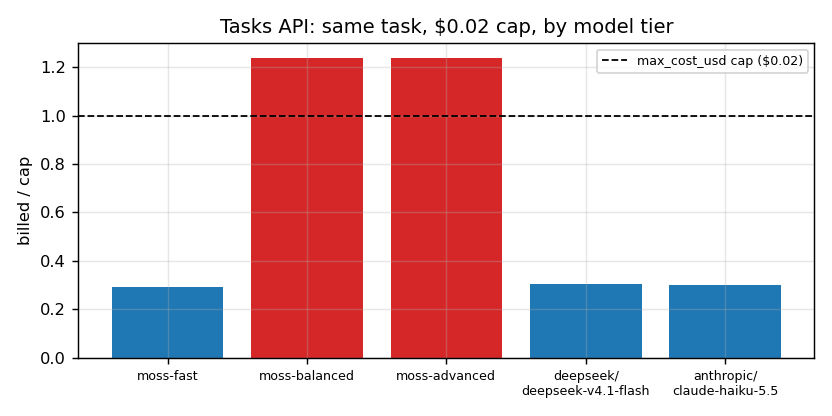

# moss-work-sample

Code and notes from me poking at Moss Inference for the ML Engineer (evals) role. Live repo: https://github.com/Anandumv/moss-work-sample

I ran this against `moss==1.26.0`, `inferedge-moss-core==0.38.0`, `moss-cli==0.4.1`, at `https://inference.moss.dev/v1`. I also built `moss-evals`, a small CLI on top of Moss: you feed it failed retrieval cases, it scores a new run, and it can fail CI when quality drops.

- [results.md](results.md) has the tables, spend and methods
- [ISSUES.md](ISSUES.md) has 18 issues, each with a repro, expected vs actual, and request/task ids
- [onepager.md](onepager.md) is the one-page writeup
- [charts/](charts/) are plots from `logs/` (`src/moss_eval/make_charts.py`)

One accounting miss: I treated local `MossClient` queries as free. They are billed at $0.50 per 1,000, and the local load test ran 41,885 of them, which used up the $10 credit. The project is paused. Details in `results.md` (spend section) and ISS-16.

## Results (short)

SciFact (5,183 docs, 300 queries, nDCG@10, 95% CI): dense `moss-minilm` is 0.653 [0.607, 0.696], no better than keyword-only 0.686. Hybrid `alpha=0.4` gets 0.725 (+0.072, p<0.001). `moss-mediumlm` is not better than `minilm` (−0.007, p=0.67). Custom `bge-small` vectors were best, 0.743.

`moss-evals` demo (60 cases from earlier misses): translating non-Latin queries moved hit@5 from 0.833 to 0.983, and the non-Latin stratum from 0/9 to 9/9. Translating every query failed the gate because two English cases got worse. Judge vs a string-match fact check: kappa 0.85–1.00.

Gateway load: 120 RPM is enforced exactly. Retrieval stays at 10–14 ms p99 even when the model is rate-limited. `Retry-After: 1` does not match `reset: 5s` (ISS-15).

Local retrieval: 359 QPS on 120 docs, p99 4.7 ms. On 5,183 docs, about 140–160 QPS, p99 under 60 ms until the process saturates. Adding concurrency inside one process does not raise QPS. Snapshot cold start is 4.2–4.6 s, then about 7 ms for the first query.

ISS-01 (retrieved context dropped after a tool call): 0/10 on both models, 10/10 after client-side Moss retrieval (W3) or `moss_search` (W2).

Tasks: prompt injection, a canary token, and off-domain lures were not followed on valid pages. The $0.02 cost cap overshot by one step (1.06–1.24x) on balanced and advanced. Ten internal or obfuscated hosts were accepted with 202 (ISS-02). Same output on 8/8 repeated runs.








## moss-evals

```bash
pip install -e .                       # gives the moss-evals command
export MOSS_PROJECT_ID=... MOSS_PROJECT_KEY=...   # or put them in .env (git-ignored)

moss-evals build-dataset --failures examples/prod_failures.jsonl --out examples/regression.jsonl
moss-evals retrieve --dataset examples/regression.jsonl --index eval-bench-minilm --alpha 1.0 --out base.json
moss-evals retrieve --dataset examples/regression.jsonl --index eval-bench-minilm --alpha 1.0 --translate --out cand.json
moss-evals judge    --dataset examples/regression.jsonl --run cand.json --out judged.json
moss-evals calibrate --dataset examples/regression.jsonl --judged judged.json
moss-evals report   --dataset examples/regression.jsonl --run cand.json --judged judged.json \
                    --baseline base.json --thresholds examples/thresholds.json \
                    --md report.md --junit junit.xml --fail-on-regression   # exit 1 on failure
```

Input is JSONL, one production event per line (`query`, `expected_ids`, and optionally `retrieved_ids`, `reference_answer`, `facts`, `feedback`, `source`). Metrics are Recall@k, hit@k, MRR and nDCG (linear gain), with seeded bootstrap CIs and a paired-bootstrap comparison to a baseline. Faithfulness is the share of answer claims the passages support, graded by `gpt-6-luna`. A gate has a `min` and a `max_drop`; a drop only fails when p < 0.05. Newly failing case ids are listed. `examples/ci/moss-evals.yml` is a sample GitHub Actions job (not enabled in this repo). Demo output is under `examples/demo_out/`.

## Layout

```text
src/moss_evals/            the CLI (metrics, dataset, runner, judge, calibrate, report)
src/moss_eval/             numbered suites 01-13c, plus common.py and make_charts.py
tests/                     test_moss_evals.py (offline) and a few live smoke tests
examples/                  sample failures, thresholds, CI workflow, demo_out/
logs/                      scrubbed JSON from each run
runs/                      SciFact rankings, if you want to re-score
charts/                    PNGs
data/                      git-ignored (SciFact + session snapshots)
```

## How to run

```bash
python3 -m venv .venv && . .venv/bin/activate && pip install -r requirements.txt && pip install -e .
PYTHONPATH=src pytest -q tests/test_moss_evals.py          # offline, no credentials
# SciFact from Hugging Face: corpus/queries parquet + qrels test.tsv into data/scifact/
#   https://huggingface.co/datasets/BeIR/scifact
#   https://huggingface.co/datasets/BeIR/scifact-qrels
PYTHONPATH=src python -m moss_eval.09_beir_scifact          # ~$3.8 at list price
PYTHONPATH=src python -m moss_eval.make_charts
```

Watch spend before you kick off a suite. Local queries cost $0.50/1k. `11b_local_load.py` is about 42k queries (~$21 at list price). Don't run that on the Developer credit unless you cut the durations.

Keys stay in `.env` (git-ignored). Logs go through `scrub_secrets`. Every number should have a file in `logs/`. Where I got a measurement wrong (base64 padding in suite 13, URL classification, the French normalizer, the fact checker, query pricing), both the mistake and the fix are in the repo.
